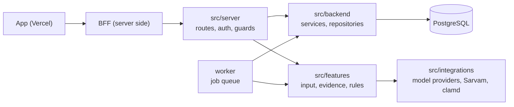

# CoverSaath

[](https://github.com/rish106-hub/CoverSaath/actions/workflows/ci.yml)
[](LICENSE)


Prototype, synthetic data only.

**AI agent working in this repo? Read [AI.md](AI.md) first**, then [AGENTS.md](AGENTS.md).

## 1. What CoverSaath is

CoverSaath is a consent-first health-insurance evidence assistant for Indian households. It helps a household understand what its own policy documents say, with every answer tied to the page it came from.

The journey:

1. The household uploads a policy schedule PDF and the policy terms and conditions (wording) PDF.
2. The backend validates and scans each file, runs OCR (Sarvam), and structures the text into clauses and facts.
3. The documents become one holding, with the schedule and the wording linked to it.
4. The household asks questions in chat. Each answer carries a verbatim quote plus the document and page it came from. When the documents do not say, the answer is "unknown".

Chat works without any model API key: with no provider configured it falls back to deterministic clause search over the household's own documents.

Rules the product keeps:

- Deterministic code decides consent, eligibility, money and release. Model output is only ever `extracted_unverified`, `conflicting` or `unknown`.
- CoverSaath does not recommend buying, switching or renewing a policy, does not predict claim outcomes, and gives no medical or legal advice.
- Consent, privacy and notice wording is a draft. **FOR LEGAL REVIEW.**

## 2. Architecture

Three repositories make up the product:

| Repository | Role |
| --- | --- |
| `CoverSaath` (this one) | Backend API, worker, database schema, evidence and rules logic |
| `CoverSaath-Frontend` | The app and its backend-for-frontend (BFF), hosted on Vercel |
| Website | Landing page and waitlist |

This repository is a Node 25+ ES-module modular monolith over one PostgreSQL database (Supabase). One Fly.io container (app `knowvia-api`, region `sin` in [fly.toml](fly.toml)) runs the API process, the job worker and clamd (ClamAV); the container entrypoint supervises all three and stops if any one stops, so Fly restarts them together. The worker claims jobs from a Postgres queue with `FOR UPDATE SKIP LOCKED`.



### Module map

| Path | Responsibility |
| --- | --- |
| `src/server/` | HTTP server, config, routes (`routes/v1-backend-routes.js` and the chat, holdings and data-lifecycle route files), worker entry |
| `src/backend/` | PostgreSQL access, repositories, services, migrations |
| `src/contracts/` | API, workflow, authority, persistence and data-purpose contracts |
| `src/features/input/` | Upload validation, protected storage, scanning, OCR |
| `src/features/policy-evidence/`, `policy-structuring/`, `policy-facts/`, `policy-identification/` | Evidence retrieval, clause structuring, facts with page provenance, UIN and insurer profile |
| `src/features/insurance-rules/`, `household-reasoning/`, `coverage-analysis/`, `decision-catalogue/`, `insurer-detection/` | Deterministic rules, collation, household reasoning, catalogue, insurer detection |
| `src/features/ai-analysis/` | Model gateway, privacy gate, grounded prompt pack, budget, chat runtime |
| `src/integrations/` | Provider adapters; import only through `src/integrations/index.js` |
| `src/shared/` | Framework-free HTTP helpers (security headers, host and origin check, rate limiter) |
| `tests/`, `scripts/` | Unit, integration, security and journey tests; database, evaluation and architecture-check commands |

`npm run check:architecture` enforces the import and naming boundaries.

### Security model

- Bearer-token auth (web sessions with JWT access tokens and rotating refresh tokens, ADR 0027). A bootstrap token only creates the first household.
- The API answers 403 to any `Host` other than loopback or a `PUBLIC_HOSTS` entry, and to any browser `Origin`. There is no CORS: the app calls the API only through the BFF, server to server.
- Household ownership is checked on every protected read and write.
- Every provider call passes the privacy gate and needs the household's current, exact consent for that provider, re-checked before the result is committed. Each model provider is its own consent recipient.
- Sensitive columns are encrypted (ADR 0013); document bytes are stored encrypted in PostgreSQL.
- Revoking consent erases derived data. Every derived store has an erasure path and a test.
- Rate limits, the model spend budget and the evidence-claim guard are shared through PostgreSQL, so machines enforce one limit; they fail closed when the store errors (ADR 0014).
- Every model call is recorded in `provider_calls` with counts, a payload hash and the `prompt_version`.
- Append-only, hash-chained audit events for protected actions.

Details: [docs/architecture/security.md](docs/architecture/security.md), [docs/architecture/processor-register.md](docs/architecture/processor-register.md).

## 3. AI layer

- **Grounded prompts.** One provider-neutral XML prompt per model purpose ([prompt-pack.js](src/features/ai-analysis/prompt-pack.js), version `grounded-pack-v1`). The system message holds `persona`, `work`, `dos`, `donts`, `industry_guardrails`, `grounding_rules` and `output_format`. The user message holds a `reference` block of document excerpts marked as untrusted data, then the request. Sampling uses the lowest temperature each provider accepts (0 where supported).
- **Routing.** `chat_answer`, `intent_classify` and `fact_extract` use the chain gemini, anthropic, openai, deepseek, kimi (`src/integrations/model-routing/index.js`). A call moves to the next provider only when the earlier one is unavailable or fails, and only if the household has consented to that provider. `embed` routes to Voyage. `MODEL_PROVIDERS` chooses which providers are enabled.
- **Adapters on main.** SDK adapters exist for Anthropic, Google (Gemini), OpenAI, DeepSeek and Kimi (PR #123, merged). A provider with no key, no rates or not listed in `MODEL_PROVIDERS` answers a typed unavailable and the next one is tried. No live call to any of them has been measured.
- **DeepSeek and Kimi** are China-hosted processors. They are off by default and must stay out of `MODEL_PROVIDERS` until legal review. **FOR LEGAL REVIEW.**
- Model output is validated against the sealed input and is never treated as confirmed.

## 4. Feature flags

Every flag is off unless its value is exactly `true`. Enabling a flag does not call a provider by itself. All settings are in [.env.example](.env.example).

| Flag | Gates |
| --- | --- |
| `SARVAM_OCR_ENABLED` | OCR jobs through Sarvam |
| `POLICY_STRUCTURING_ENABLED` | Policy clause structuring runs |
| `POLICY_EVIDENCE_ENABLED` | Evidence retrieval and investigation for questions |
| `POLICY_FACTS_ENABLED` | Policy facts and fact evidence, and their worker jobs |
| `DOCUMENT_READBACK_ENABLED` | Deterministic document readback (no model call) |
| `CATALOGUE_INDEPENDENT_REVIEW_ENABLED` | Independent review step of the decision catalogue |
| `REFERENCE_DATA_ENABLED` | Reference-data import (insurer product reference) |
| `HOLDINGS_ENABLED` | Holdings, declarations, premiums, dues, hospitals routes and the holdings worker jobs |
| `MEMORY_ENABLED` | Household memory writes and retrieval, chat v1 threads and turns |
| `CHAT_ENABLED` | Chat v0 |
| `CHAT_MODEL_ENABLED` | The model wording step of a chat turn; without it chat answers from code and stored facts |
| `ANALYTICS_ENABLED` | Consent-gated analytics outbox and drain (also needs its own salt, key, host and an active consent grant) |
| `VOICE_AUDIO_RETAIN` | Keeps a voice note's audio document; the transcript is stored either way, sealed |

`APP_EVENTS_ENABLED` is the one exception: it is on unless set to `false`.

## 5. Run locally and test

Requirements: Node 25 or later (CI uses Node 26), npm, and PostgreSQL 17 (with pgvector for the memory tests; CI uses a pinned pgvector image).

```sh
npm ci
cp .env.example .env.local     # set DATABASE_URL, KNOWVIA_BOOTSTRAP_TOKEN (32+ chars), DOCUMENT_ENCRYPTION_KEY_BASE64
npm run db:init                # apply migrations
npm run dev                    # http://127.0.0.1:8787
```

Optional: `npm run worker` runs the job worker alone; `npm run seed:demo` loads a synthetic demo household into a loopback database.

| Command | Use |
| --- | --- |
| `npm run check` | Architecture boundaries, all tests, entry-point check |
| `npm test` | Tests only |
| `npm run eval:safety` | Safety evaluations |
| `npm run check:architecture` | Import and naming boundaries |
| `node --test tests/<file>.test.mjs` | One test file |
| `git diff --check` | Whitespace |
| `gitleaks git .` | Secret scan of full history |

Tests need `TEST_DATABASE_URL` pointing at a local PostgreSQL 17 ([local-postgres runbook](docs/runbooks/local-postgres.md)). Set `REQUIRE_POSTGRES=1` to fail instead of skipping when it is missing. Tests use local provider stubs and synthetic data; they do not prove live provider behaviour or OCR accuracy.

Legacy `knowvia` names (variables, database values, the Fly app) stay until a compatibility plan exists.

## 6. Deploy

Target: Fly.io app `knowvia-api` with Supabase PostgreSQL ([ADR 0011](docs/adr/0011-supabase-master-database.md)), built from [Dockerfile](Dockerfile) and [fly.toml](fly.toml). Deployment needs explicit owner approval. Short form:

1. Apply migrations from an operator machine over the direct or session-pooler database URL (`npm run db:init`), never through the runtime pooler URL.
2. Set secrets on the app (database URL, encryption keys, bootstrap token); never in `fly.toml`.
3. `fly deploy --remote-only -a knowvia-api`, then verify `/api/v1/health`, `/api/v1/ready` and the host guard.

Full steps, pooler probe, staging plan and recovery: [docs/runbooks/fly-deploy.md](docs/runbooks/fly-deploy.md).

## 7. Status

### What is built

Backend, merged to main:

- [x] Document intake: validation, encrypted storage in PostgreSQL, ClamAV scanning, Sarvam OCR, page blocks (migrations 001-020)
- [x] Policy structuring, evidence retrieval, facts with page provenance, policy profile (UIN, insurer, page count) (007-014, 041-044)
- [x] Consent, revocation and erasure; append-only audit events; consent-gated analytics outbox and PostHog drain (migration 057, ADR 0033)
- [x] Column encryption and document bytes in the database (ADR 0013)
- [x] Web sessions, JWT access tokens, rotating refresh tokens (045, ADR 0027); household sync change log (046, ADR 0028); person records (047, ADR 0026)
- [x] Holdings, household memory facts, conflicts, declarations, premium payments and dues (048-052, ADR 0032); a holding is created when OCR completes
- [x] Two-document holding: wording linked to a holding, chat cites the wording page and own-PDF readings (065, PR #121)
- [x] IDA reference fetch and insurer detection (PR #97); network hospitals lookup filtered by the holding's insurer (055, PR #113)
- [x] Memory chunks with pgvector and Voyage embeddings, chat v1 threads, streamed turns and traces (053-054, ADR 0031)
- [x] Model gateway: provider routing, Anthropic and Gemini adapters, redaction gate, `provider_calls` (056, ADR 0030)
- [x] Grounded XML prompt pack for every model purpose (PR #120)
- [x] No-key chat funnel (deterministic clause search) and per-provider consent failover (PR #119); current exact consent required before chat and embed calls (058, PR #114)
- [x] Chat integrity fixes: registry recipients, number check, owner-only facts (PR #115)
- [x] Shared per-adult limits and model budget in PostgreSQL, fail closed (023, 032, PR #116, ADR 0014)
- [x] Job worker runs inside the Fly container (PR #117)
- [x] Provider SDK adapters for OpenAI, DeepSeek, Kimi and Anthropic, SDK upgrades (PR #123)
- [x] Synthetic demo seed (`npm run seed:demo`)
- [x] CI: pinned pgvector PostgreSQL 17 image, gitleaks scan, architecture check

The app and BFF live in `CoverSaath-Frontend`; their features are tracked in that repository.

### What is left

- [ ] The frontend must call the link-wording route (`POST /api/v1/holdings/{id}/documents`) after a wording upload
- [ ] Production reference-data reader is not wired: the insurer tier is empty until it is
- [ ] Live-model evaluation of grounding and refusal behaviour has not been measured; tests use stubs
- [ ] Legal review of consent, notice and persona wording, and of voice transcript storage and cross-border model calls. **FOR LEGAL REVIEW.**
- [ ] Legal review before DeepSeek or Kimi are ever enabled (China-hosted). **FOR LEGAL REVIEW.**
- [ ] Provider keys not set: Anthropic, OpenAI, Voyage
- [ ] OCR reliability follow-ups from the audit: F6 (failed OCR hook leaves no holding and nothing retries), F9 (failed-persistence OCR job can complete after revocation), F10 (`parse_completed.facts` counts every memory row)
- [ ] Audit P3 items: F11 (hospital list has no pagination), F12 (analytics revocation is lazy; sent events stay in PostHog), F13 (outbox drain holds row locks across the PostHog call)
- [ ] Other audit items not confirmed fixed on main: F4 (in-tier own-PDF conflicts get no conflict row), F14 (CodeQL alerts on frontend test code)
- [ ] Chat procedure planning is not wired to the hospitals lookup; analytics events `voice_turn` and `hospital_search` are allowed but nothing emits them
- [ ] Retention for expired (not revoked) consent is an open owner decision
- [ ] Capacity and load numbers do not exist; Sydney or Singapore hosting is for synthetic data only, and real Indian health data needs a residency and legal decision (ADR 0011 D8)

Current detail: [docs/iterations/LATEST.md](docs/iterations/LATEST.md) and [docs/audits/2026-11-13-complete-audit.md](docs/audits/2026-11-13-complete-audit.md).

## 8. Docs index

| Topic | File |
| --- | --- |
| Agent orientation and rules | [AI.md](AI.md), [AGENTS.md](AGENTS.md) |
| Run the P0 journey (two PDFs, one holding, chat) | [docs/runbooks/demo-journey.md](docs/runbooks/demo-journey.md) |
| Current state | [docs/iterations/LATEST.md](docs/iterations/LATEST.md) |
| System and data architecture | [docs/architecture/system.md](docs/architecture/system.md), [docs/architecture/data.md](docs/architecture/data.md), [docs/architecture/security.md](docs/architecture/security.md) |
| Decisions | [docs/adr](docs/adr) |
| Audit | [docs/audits/2026-11-13-complete-audit.md](docs/audits/2026-11-13-complete-audit.md) |
| Deploy and recovery | [docs/runbooks/fly-deploy.md](docs/runbooks/fly-deploy.md) |
| Local database | [docs/runbooks/local-postgres.md](docs/runbooks/local-postgres.md) |
| Chat and memory | [docs/runbooks/chat-and-memory.md](docs/runbooks/chat-and-memory.md) |
| Reference data and hospital sync | [docs/runbooks/ida-sync.md](docs/runbooks/ida-sync.md) |
| CI gates | [docs/runbooks/ci-gates.md](docs/runbooks/ci-gates.md) |
| Incident response | [docs/runbooks/incident-response.md](docs/runbooks/incident-response.md) |
| Product behaviour sources | `working/`, `building/` |
| Security reporting | [SECURITY.md](SECURITY.md) |

## License

[Apache-2.0](LICENSE). The public project name is CoverSaath.
