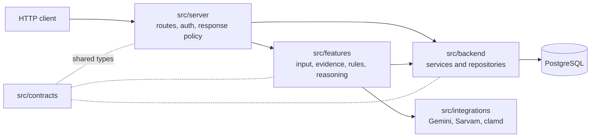

# CoverSaath

[](https://github.com/rish106-hub/CoverSaath/actions/workflows/ci.yml)
[](LICENSE)


A backend-first, consent-first health-insurance evidence system. Households upload their policy documents; CoverSaath reads them, keeps every extracted fact tied to its source page, and answers questions with citations and visible uncertainty. Deterministic code owns every consent, eligibility, money and release decision. Model output is only ever `extracted_unverified`, `conflicting` or `unknown`.

> **Status: prototype.** Synthetic data only. Not an insurance adviser, a claims platform, or a production-ready service. Authentication is local prototype authentication. Consent and privacy wording is a draft that needs legal review.

**AI agent working in this repo? Read [AI.md](AI.md) first**, then [AGENTS.md](AGENTS.md).

## What it does

- **Intake**: validates uploads, stores bytes encrypted, scans for malware, and runs OCR (Sarvam, off by default).
- **Evidence**: structures policy text into clauses and facts with page-level provenance, then retrieves cited evidence for a question.
- **Reasoning**: compares household coverage with deterministic rules and lists the gaps and next actions.
- **Consent and erasure**: every provider call needs current, exact consent. Revoking consent stops in-flight work and erases derived data.
- **Audit**: append-only, hash-chained audit events for protected actions.

## Architecture

One Node.js modular monolith over one PostgreSQL database. The agents in `src/agents/` are in-process modules, not services.



Decisions live in [docs/adr](docs/adr); the current system map is [docs/architecture/system.md](docs/architecture/system.md).

## Quick start

Requirements: Node 25 or later (CI uses Node 26), npm, and PostgreSQL 17 for the database and tests.

```sh
npm ci
cp .env.example .env.local        # then fill in the values below
npm run db:init                   # applies migrations to DATABASE_URL
npm run dev                       # http://127.0.0.1:8787, restarts on change
```

Minimum `.env.local` for local work:

| Variable | Value |
| --- | --- |
| `DATABASE_URL` | Local PostgreSQL URL. For Supabase use the session pooler, see [fly-deploy runbook](docs/runbooks/fly-deploy.md). |
| `KNOWVIA_BOOTSTRAP_TOKEN` | Random value of 32+ characters: `openssl rand -hex 32`. Only creates the first household. |
| `DOCUMENT_ENCRYPTION_KEY_BASE64` | `openssl rand -base64 32`. Without it, document intake fails closed. |

Provider switches (`SARVAM_OCR_ENABLED`, `POLICY_EVIDENCE_ENABLED`, `POLICY_STRUCTURING_ENABLED`, `CATALOGUE_INDEPENDENT_REVIEW_ENABLED`) are off unless set to exactly `true`. Enabling one does not call a provider by itself. Every setting is documented in [.env.example](.env.example). Legacy `knowvia` names in variables and database values are kept on purpose until a compatibility plan exists.

Check it is up:

```sh
curl -s http://127.0.0.1:8787/api/v1/health
curl -s http://127.0.0.1:8787/api/v1/ready
```

A local PostgreSQL for development and tests: [docs/runbooks/local-postgres.md](docs/runbooks/local-postgres.md).

## API

All routes are under `/api/v1` and, except health, need a session, household ownership and the relevant consent.

| Area | Routes |
| --- | --- |
| Health | `GET /health`, `/live`, `/ready` |
| Households and sessions | `POST /households`, `GET /households/{id}`, `POST /sessions/current/revoke` |
| Consent | `POST /consents`, `POST /consents/{id}/revoke`, field access check |
| Cases | `POST /cases`, `GET /cases/{id}`, `POST /cases/{id}/transitions`, `GET /cases/{id}/audit-events` |
| Documents | `POST /cases/{id}/documents` (PDF), `GET /cases/{id}/documents`, `GET`/`DELETE /documents/{id}`, deletion inventory |
| OCR and structuring | `POST /documents/{id}/ocr-jobs`, `POST /ocr-jobs/{id}/refresh`, `POST`/`GET /documents/{id}/structuring-runs` |
| Evidence | `POST`/`GET /cases/{id}/questions`, `GET /cases/{id}/decision-catalogue`, `GET /cases/{id}/source-pack` |
| Reasoning | `POST /households/{id}/coverage-preview`, `POST /cases/{id}/analysis-runs`, `GET /jobs/{runId}`, `GET /tasks/{taskId}` |

Source of truth for routes is [src/server/routes/v1-backend-routes.js](src/server/routes/v1-backend-routes.js). Errors are coded and client-safe. There is no active UI; a UI talks to this contract through a server-side backend-for-frontend (see [AI.md](AI.md)).

## Repository map

```text
src/
├── agents/         bounded analysis specialists (in-process)
├── backend/        PostgreSQL access, repositories, services, case state
├── contracts/      API, workflow, authority and persistence contracts
├── evaluation/     offline safety evaluation
├── features/       input, ai-analysis, coverage-analysis, policy-evidence,
│                   policy-structuring, insurance-rules, decision-catalogue,
│                   household-reasoning
├── integrations/   fail-closed provider adapters (import via index.js)
├── server/         API composition, routes, response policies
└── shared/         framework-free HTTP helpers
tests/              unit, integration, security and journey tests
scripts/            database, evaluation and architecture-check commands
docs/               adr/, architecture/, runbooks/, exec-plans/, iterations/
working/ building/  product behaviour and policy-decomposition sources
```

Files and directories use lowercase kebab-case. `npm run check:architecture` enforces the boundaries.

## Verify a change

```sh
npm run check            # architecture boundaries, tests, entry-point validation
npm run eval:safety      # safety evaluation
git diff --check
```

Tests need `TEST_DATABASE_URL` (a local PostgreSQL 17). Set `REQUIRE_POSTGRES=1` to fail instead of skip when it is missing. Tests use synthetic records only. Mocked provider tests do not prove live provider behaviour, OCR accuracy, insurer decisions or production safety.

## Deployment

Target: Fly.io app `knowvia-api` in Sydney, with Supabase PostgreSQL ([ADR 0011](docs/adr/0011-supabase-master-database.md)). The container is built from [Dockerfile](Dockerfile) and [fly.toml](fly.toml). Steps and recovery: [docs/runbooks/fly-deploy.md](docs/runbooks/fly-deploy.md). The API is local-only unless `PUBLIC_HOSTS` opts a host in.

## Security

- Synthetic data only. No real policies, medical records, credentials or personal data in code, logs, fixtures or commits.
- Secrets stay in ignored `.env.local` or the host's secret store. Scan the full history with `gitleaks git .`; test fixtures that look like keys are allowlisted in [.gitleaks.toml](.gitleaks.toml).
- Report vulnerabilities privately; see [SECURITY.md](SECURITY.md).

## Known limits

- Authentication is local prototype authentication, not production identity.
- Live provider journeys and production deployment are unverified.
- Rate limiting and some claims are per process, so scaling past one machine needs work first.
- No capacity or load-test numbers exist; make no scale claims.
- Sydney hosting is for synthetic data only; real Indian health data needs a residency and legal decision (ADR 0011 D8).

## Contributing

Read [AGENTS.md](AGENTS.md) for the working rules (acceptance criteria first, smallest safe change, evidence before claiming success). Do not commit, push, merge or deploy unless the task asks for it. Current project state is in [docs/iterations/LATEST.md](docs/iterations/LATEST.md).

## License

[Apache-2.0](LICENSE). The public project name is CoverSaath.
