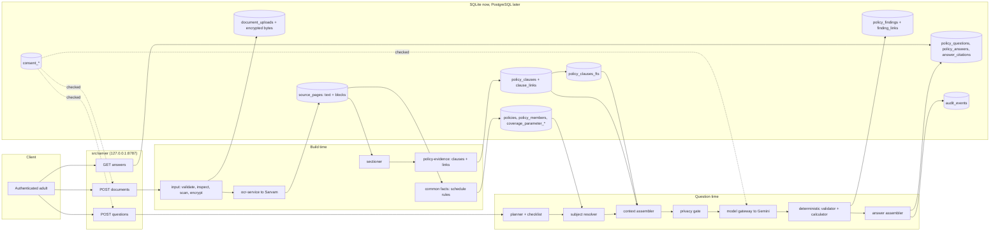

# Evidence-first reasoning architecture

Status: **proposed**, 2026-10-20. Nothing here is built yet. This document details the direction in [../exec-plans/active/direction-change.md](../exec-plans/active/direction-change.md); ADR 0008 is to record it. Companion documents: [system.md](system.md), [data.md](data.md), [security.md](security.md), [pipeline-blocks.md](pipeline-blocks.md).

Facts marked *(measured)* come from the 2026-10-20 live run on one sanitised 20-page policy. Nothing here is a capacity, scale or accuracy claim.

## 1. What we are building

A backend that, for one household case, can:
1. hold every clause of every policy document in the case, unchanged and traceable to page and block;
2. answer a coverage question by investigating the policy: find the relevant clauses, then the clauses that limit, exclude, waive or override them;
3. return a **cited, conditional answer**: what is covered, what is limited or excluded, which conditions apply, what is unknown, and where each statement comes from.

It does not decide coverage. Model output stays `extracted_unverified`, `conflicting` or `unknown` (ADR 0003). Arithmetic and member eligibility are deterministic code. Consequential decisions go to human verification.

"RAG" here means **retrieval or whole-document reading, followed by grounded extraction**. For one policy within the token budget, the "retrieval" step is reading the whole gated policy. Keyword retrieval (FTS5) is used only above the budget.

## 2. End-to-end process

Two time scales: **build time** (once per document version) and **question time** (once per question).

### Build time: from PDF to knowledge base

| Step | What happens | Owner (path) | Status |
|---|---|---|---|
| B1 Intake | Upload, file validation, PDF inspection in a sandbox, ClamAV scan, AES-256-GCM encryption at rest | `src/features/input/` | Built |
| B2 Digitise | 10-page segments sent to Sarvam Document AI; `source_pages` rows with `extracted_text` and `blocks_json` (tag, reading order, text) | `src/features/input/ocr-service.js`, `src/integrations/sarvam/` | Built |
| B3 Section | Blocks become chunks by section title and table; headers, footers and page numbers dropped | `src/features/policy-structuring/sectioner.js` | Built |
| B4 **Clause build** | Each chunk becomes a `policy_clause` row with a stable id, page, block indexes, section path, deterministic `kind`, and **gated text** (privacy gate placeholders) | new `src/features/policy-evidence/clauses.js` | New |
| B5 **Cross-reference** | Deterministic detection of references between clauses ("as stipulated in the Policy Schedule", "subject to Section 4.2", "Code-Excl03", defined terms) stored as `clause_links` | new `policy-evidence/links.js` | New |
| B6 Common facts | Deterministic schedule rules (`eval-extractor.js` `extractFields`) fill insurer, plan, policy number (masked), members, period, sum insured, premium and limits. Stored as registry observations with authority `deterministic`, and as `policies` / `policy_members` rows with masked identifiers | `src/features/ai-analysis/eval-extractor.js`, new adapter | Partly built (rules exist, not stored) |
| B7 Index | `policy_clauses_fts` (FTS5 over gated text only) in the same transaction as B4 | new migration | New |
| B8 Optional catalogue | Existing whole-document structuring (registry plus proposals) can still run as a pre-computed "common facts" pass. It is no longer required for answers | `src/features/policy-structuring/` | Built (demoted) |

Build time needs the existing consent for document processing and Sarvam. B4–B7 make **no model call**. The model is only needed at B8, which is optional.

### Question time: from question to cited answer

| Step | What happens | Model? |
|---|---|---|
| Q1 Accept | `POST /api/v1/cases/:caseId/questions` with session, household ownership check, idempotency key, `answer` consent for `google-gemini` (new purpose; legal review) | No |
| Q2 **Plan** | Classify the question into a type (coverage of a treatment, a claim scenario, a limit lookup, a comparison) and expand it into a checklist of required clause kinds. A coverage question needs member, benefit, limit, waiting_period, exclusion, definition, endorsement and schedule_fact. Rules first; a model may only *add* checklist items, never remove them | Rules, with an optional bounded model call |
| Q3 **Resolve subject** | "My mother" maps deterministically to a `household_member`, then to `policy_members`. The model only ever sees a placeholder such as `[MEMBER_2]` | No |
| Q4 **Assemble context** | If the gated policy (plus endorsements) fits within the budget (provisional 120k tokens), include **all clauses**. Otherwise use FTS5 top-k per checklist kind, plus *all* endorsement, schedule and definition clauses, plus every clause linked by `clause_links` to a selected clause | No |
| Q5 **Extract findings** | Gemini returns findings: clause ids, verbatim quote, subject, appliesTo, conditions, exceptions, value, state | Yes (1 call) |
| Q6 **Override sweep** (mandatory) | A second call is given the findings and the context and asked only for clauses that limit, exclude, waive or override them. Its output becomes `finding_links` (overrides, limits, waives, conflicts) | Yes (1 call) |
| Q7 **Validate** | Deterministic: clause id exists in this case; quote is verbatim in the clause's gated text; value normalised (`validator.js`); a finding never claims above `extracted_unverified`; every checklist kind is either covered by a finding or listed as an unknown | No |
| Q8 **Calculate** | Deterministic arithmetic over validated values: room-rent proportion, co-pay, caps per eye, remaining sum insured. Shown with inputs and method | No |
| Q9 **Assemble answer** | Code, not the model, builds the answer structure: covered, limited or excluded, conditions, overrides checked, unknowns, calculations, sources, and a legal-review marker | No |
| Q10 Persist and return | Store the question, answer and citations; audit with counts only; return through a read-response policy | No |

Two model calls per question is the baseline. Consent is re-checked before each call and before commit.

## 3. Architecture



### New modules

| Path | Responsibility | Reuses |
|---|---|---|
| `src/features/policy-evidence/index.js` | Public surface of the feature | — |
| `policy-evidence/clauses.js` | Chunk to clause; deterministic `kind` from block tag, section title and keyword rules | `sectioner.js`, `privacy-evidence-gate.js` |
| `policy-evidence/links.js` | Cross-reference and defined-term detection | — |
| `policy-evidence/planner.js` | Question type to checklist of clause kinds | — |
| `policy-evidence/context.js` | Budgeted whole-policy or FTS assembly | `policy-clause-repository.js` |
| `policy-evidence/investigate.js` | Q5 and Q6 calls, consent re-check, caps | `model-gateway.js`, `extractor.js` patterns |
| `policy-evidence/validate.js` | Quote, clause and value checks | `validator.js` (`normalizeValue`, `inferValueType`) |
| `policy-evidence/calculate.js` | Deterministic money and date arithmetic | `src/features/insurance-rules/` where applicable |
| `policy-evidence/answer.js` | Answer contract assembly | — |
| `src/contracts/policy-evidence.js` | Clause, finding and answer contracts, kind enums, versions | — |
| `src/backend/repositories/policy-clause-repository.js`, `policy-answer-repository.js` | Persistence, ownership and erasure | existing repository patterns |
| `src/server/routes/` additions | Question and answer routes | `read-response-policy.js` |

## 4. Data flow

### 4.1 Build-time flow (one document version)

```
PDF bytes ──► validate + sandboxed inspect + ClamAV ──► AES-256-GCM file (.local/documents)
                                                  │
                                                  ▼
                              Sarvam (10-page segments, JSON) ──► source_pages
                                                                  ├─ extracted_text (plaintext, raw)
                                                                  └─ blocks_json   (tag, order, text)
                                                                          │
                     ┌────────────────────────────────────────────────────┤
                     ▼                                                    ▼
          schedule rules (local)                               sectioner ─► chunks
          ├─ policies (masked number, dates)                              │
          ├─ policy_members (masked refs)                    privacy gate (placeholders)
          └─ coverage_parameter_observations                              │
             (authority deterministic)                                    ▼
                                                    policy_clauses (gated text, kind, page, blocks)
                                                    ├─ clause_links (refers_to, defines, amends)
                                                    └─ policy_clauses_fts (gated text only)
```

What leaves the machine at build time: PDF segments to Sarvam only, under the existing consent. Nothing goes to Gemini unless the optional catalogue pass (B8) runs.

### 4.2 Question-time flow

```
question ─► consent(answer) ─► planner ─► checklist kinds
                                   │
member words ─► subject resolver ─► [MEMBER_n] placeholder (deterministic map kept server-side)
                                   │
           ┌───────────── context assembler ──────────────┐
           │ under budget: all gated clauses              │
           │ over budget: FTS top-k per kind + endorse-   │
           │ ments + schedule + definitions + linked      │
           └───────────────────────┬──────────────────────┘
                                   ▼
             Gemini call 1: findings (clause ids + quotes)
                                   ▼
             Gemini call 2: override sweep (limits, exclusions, waivers)
                                   ▼
             validate (quote ∈ clause, ids, values, state cap)
                                   ▼
             calculate (deterministic) ─► answer assembler ─► policy_answers + answer_citations
```

What leaves the machine at question time: gated clause text (placeholders, no identifiers), the question with member words replaced, and the checklist. Never the PDF, never raw `extracted_text`, never identifiers.

## 5. Data model (new stores)

All tables are `STRICT`, household-scoped, and covered by the erasure triggers and repository paths listed in section 8. Postgres mirrors arrive under ADR 0004.

| Table | Key columns | Notes |
|---|---|---|
| `policy_clauses` | id, household_id, case_id, document_id, source_version, page, block_indexes_json, section_path, kind, gated_text, gated_digest, gate_status (`sent`/`refused`/`truncated`), clause_version, created_at, redacted_at | Stores **gated** text only. Raw text stays only in `source_pages`. A refused clause is kept with no text and excluded from model context, and its kind is still searchable. |
| `policy_clauses_fts` | FTS5 external-content over `policy_clauses.gated_text`, tokenizer `porter unicode61` | Rebuilt or deleted in the same transaction as clause writes and redactions. FTS has no triggers by default, so erasure is explicit and tested. |
| `clause_links` | id, from_clause_id, to_clause_id or to_document_kind, link_type (`refers_to`, `defines`, `amends`, `as_per_schedule`), source (`rule`/`model`), created_at | Deterministic first. Model-sourced links come only from the Q6 sweep, stored as `finding_links`. |
| `policy_findings` | id, answer_id (nullable for catalogue findings), household_id, clause_ids_json, quote, subject, applies_to, conditions_json, exceptions_json, value_json, normalized_json, open_kind, registry_key (nullable), state (`extracted_unverified`/`conflicting`/`unknown`), extractor_version, created_at, redacted_at | Open-ended: `open_kind` is free text and `registry_key` is optional. |
| `finding_links` | id, from_finding_id, to_finding_id or to_clause_id, relation (`limits`, `excludes`, `waives`, `overrides`, `conflicts`), source (`sweep`/`rule`) | Feeds the answer's "overrides checked" section. |
| `policy_questions` | id, household_id, case_id, asked_by, question_text, question_type, checklist_json, subject_member_id, created_at, redacted_at | `question_text` is user input and is treated as sensitive. |
| `policy_answers` | id, question_id, state, answer_json (contract), context_mode (`whole`/`retrieved`), token_usage_json, cost_minor, pipeline_version, created_at, redacted_at | Never a bare yes or no. |
| `answer_citations` | answer_id, finding_id, clause_id, page, role (`supports`/`limits`/`excludes`/`unknown_basis`) | Lets the client render sources. |

Why not reuse `evidence_facts`: its states are `known`/`unknown`/`conflict`, and `known` is not allowed for model output. `evidence_facts` stays the home for **verified** facts. A finding becomes an evidence fact only through `human_reviews`.

## 6. How today's stored data maps to this pipeline

Every store the 2026-10-20 run produced, and its role from here on:

| Existing store | Contents *(measured where stated)* | Role in the evidence-first pipeline |
|---|---|---|
| `document_uploads` + encrypted file | 1 document, AES-256-GCM bytes | Unchanged. Root of provenance and erasure. |
| `ocr_jobs` | 1 succeeded job | Unchanged. The version gate for clause builds. |
| `source_pages.extracted_text` | 20 pages, about 69k characters (about 17k tokens) *(measured)* | **Raw truth.** Used for quote verification only. Never sent to a model and never indexed. |
| `source_pages.blocks_json` | 219 blocks: 63 paragraph, 24 table, 13 section-title, 57 header, 29 footer and others *(measured)* | **Primary input** to clauses (B3–B4). Headers, footers and page numbers are dropped. |
| `coverage_parameter_records/observations/resolutions` | 138 records, 110 observations *(measured)* | **Common-facts catalogue.** Injected into context as pre-cited facts, and used for subject resolution and calculations. Optional, not required. |
| `proposed_parameters` | 56 open-ended items *(measured)* | **Seed findings** with `open_kind` = proposed key, and a signal for clause-kind rules. Each keeps page and block, so it maps to a clause. |
| Structuring contradictions/variations | 4 contradictions, 13 variations *(measured)* | **Override hints**: the clauses involved get `clause_links` candidates and are always included in the override sweep context. |
| `policy_structuring_runs` | 1 run, counts only | Kept as the catalogue-run record. |
| `policies`, `policy_members`, `insurers` | Empty today | **Host for common identity facts** from the schedule rules: masked policy number, dates, members. Used by Q3 subject resolution. |
| `evidence_facts`, `fact_conflicts` | Empty | Verified facts after human review. |
| `consent_grants/scopes` | 4 grants, 5 scopes | New scope action `answer`, recipient `google-gemini`. |
| `audit_events` | 39 events | Gets new counts-only events: clauses_built, question_answered, answer_erased. |
| Provider traces in `.local/live-backend-run-*/` | Raw prompts and outputs | **Not part of the system.** Local debugging only; delete after use. |

## 7. Data hosting

### Today (local only)

| Data | Where | Protection | Gap |
|---|---|---|---|
| PDF bytes | `DOCUMENT_STORAGE_PATH` (default `.local/documents`) | AES-256-GCM, key from `DOCUMENT_ENCRYPTION_KEY_BASE64`, file mode 600 | Key in env file; no KMS |
| Database | One SQLite file, `DATABASE_PATH` (intended `.local/knowvia.sqlite`; currently resolves to `.local/.local/` due to a bug, fixed in Phase A S7) | Mode 600, directory 700, WAL | **Not encrypted at rest.** OCR text is plaintext |
| New clause store, FTS, findings, answers | Same SQLite file | Gated text only (no identifiers) | Questions and answers are user-sensitive and plaintext |
| Model and OCR providers | Sarvam (OCR), Google Gemini (findings, sweep) | Privacy gate before Gemini; consent per document and purpose | **Provider retention and region not verified.** Open owner and legal decision |
| Secrets | `.env.local` | Git-ignored | No secret manager |
| Host | One Node process on `127.0.0.1:8787` | Loopback only | No deployment target exists |

### Later (needs decisions, not assumed)

- **Database:** PostgreSQL per ADR 0004 (S3.2). FTS5 is replaced by `tsvector` with a GIN index on the gated text; the clause, finding and answer tables port one to one. Embeddings or `pgvector` only if the measured recall eval (section 9) fails on keyword plus whole-document reading, and only with an ADR.
- **Bytes:** object storage behind the existing byte-storage port, still encrypted client-side.
- **Region and residency:** undecided. India's DPDP Act obligations and the providers' processing regions need legal review before any hosted deployment. Whole-policy context sends more clause text per question than top-k does, though gated, which the consent wording must cover.
- **Encryption of OCR text at rest:** a needed follow-up; needs an ADR.

## 8. Privacy, consent and erasure for each store

| Store | Gate | Consent | Erasure path (must have a test) |
|---|---|---|---|
| `policy_clauses` | Gated at build; refused clauses keep no text | document processing | Redact on revocation or document erasure: null `gated_text`, set `redacted_at` (trigger like `005`/`009`) |
| `policy_clauses_fts` | Indexes gated text only | — | Explicit FTS `delete` in the same transaction; test that a search after revocation returns 0 |
| `clause_links` | No text | — | Delete with the clause |
| `policy_findings`, `finding_links` | Quotes come from gated text | `answer` | Redact on revocation or document erasure |
| `policy_questions`, `policy_answers`, `answer_citations` | Member words replaced before the model call | `answer` | Redact on revocation; erased when the case is erased |
| Placeholder-to-member map | Never stored with the prompt; computed per request | — | Nothing to erase |

Every Gemini payload passes `sanitizeEvidenceTextForStorage` and the outgoing-payload tests. The card-false-positive fix (Phase A S1) is a prerequisite: today the policy number causes whole schedule clauses to be refused.

## 9. Evaluation and gates

| Metric | Definition | Pass (provisional, n=1 document) |
|---|---|---|
| R1 Required-clause recall | Share of owner-listed required pages cited per question | ≥ 95% overall; **100% of override and exception pages** (a miss is a hard block) |
| R2 Unsupported findings | Findings whose quote is not in the cited clause | 0 |
| R3 Honest unknowns | Questions built with missing evidence return the gap as unknown | 100% |
| R4 Context budget | Share of single-policy questions answered in whole-policy mode | Reported |
| R5 Cost per question | Measured provider cost | Reported; provisional ceiling $0.10 |
| R6 Privacy | Identifiers in prompts, audit, logs | 0 (hard block) |
| R7 Erasure | Rows readable after revocation across all new stores | 0 |

Golden question set: `.local/eval/golden-questions.json` (owner-authored, git-ignored). It starts with 15 questions on the current policy, each listing the required pages, including overrides.

## 10. Open decisions

1. Consent wording and the scope for the `answer` purpose (legal review).
2. Provider retention, region and data residency (legal and vendor).
3. Token budget for whole-policy mode (provisional 120k; measure).
4. Whether B8 (the full registry catalogue pass) keeps running at build time, or only on demand.
5. Encrypting OCR text and answers at rest.
6. Retention period for questions and answers.

## 11. Build order

This follows [direction-change.md](../exec-plans/active/direction-change.md):

1. Phase A: S0 scorer, S1 gate card fix, S2 target fix, S7 database path.
2. B0: ADR 0008 and the consent scope.
3. B1: clause store, links, FTS, with erasure (migrations 015+ and Postgres parity).
4. B6: store common facts from the schedule rules.
5. B3: investigation (planner, context, two calls, validation, calculation, answer).
6. B4: question and answer API.
7. B5: recall eval. Paid runs need explicit approval.
